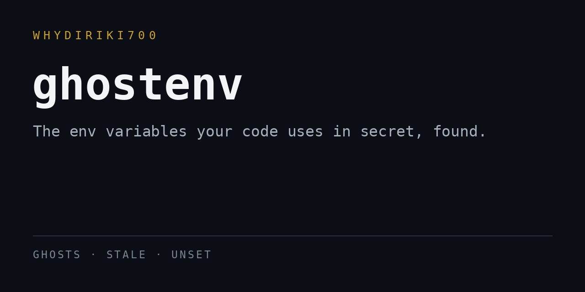

# ghostenv

Your code reads environment variables your .env.example never mentions. They are ghosts: invisible in review, invisible in docs, and they appear exactly once, at deploy time, as a crash. ghostenv hunts them. Zero dependencies.

## What it does

ghostenv scans Python, JavaScript, TypeScript, and shell sources for environment variable reads, collects every variable name the code actually uses, and compares the set against your `.env.example` (or `.env.sample`, `.env.template`, `.env.dist`). It reports three lists:

- **Ghosts**: used in code, documented nowhere. These break deploys.
- **Stale**: documented, used nowhere. Dead weight that misleads the next reader.
- **Unset**: used and documented, but missing from your real `.env`, when one exists.

Only names are ever read. Values in any env file are ignored completely and never printed.

## Usage

```bash
python -m ghostenv               # scan the current project
python -m ghostenv --root ../app # scan another project
python -m ghostenv --json        # machine readable report
```

## Example output

```text
Used in code: 14   Documented: 12   Clean: 11

GHOSTS (used in code, missing from .env.example)
  STRIPE_WEBHOOK_SECRET   in src/billing.py
  LEGACY_API_URL   in web.js, worker.js

STALE (documented, never used in code)
  OLD_FEATURE_FLAG

UNSET (used and documented, missing from your .env)
  DATABASE_URL
```

Exit code is 1 when ghosts exist, 0 when every used variable is documented, so it fits a CI step or a pre-push hook. Variable names are matched in upper snake case, the convention every framework expects.

## Requirements

Python 3.8 or newer. No packages to install.

## License

MIT. See `LICENSE`.
